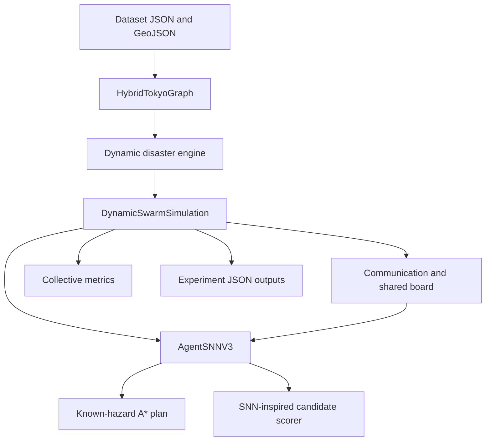

# Beyond Task Success: Measuring Collective Intelligence in Algorithmic Multi-Agent Disaster Navigation

This repository contains a rule-based, in-process multi-agent disaster-navigation testbed built on a Tokyo urban road network. The project evaluates collective intelligence beyond final task success by measuring task performance, navigation effort, information transfer, replanning, spatial coverage, shared mechanisms, and team-size scaling.

The agents are **algorithmic and rule-based**. Navigation is primarily planner-assisted: a bounded A* search is used when a navigator has an active known-hazard plan, while an SNN-inspired candidate-scoring mechanism provides a fallback policy.

## Research Objectives and Contributions

The implementation supports the following research dimensions:

- **Navigation:** individual serial execution, independent parallel execution, and coordinated execution.
- **Disaster adaptation:** earthquake and flood hazards represented as spatial node damage and disabled edges.
- **Dynamic environments:** optional aftershocks, rubble spread, expanding floods, fire spread, and compound hazards.
- **Communication:** range-limited local hazard messages, configurable delays, contact synchronization, and shared-board posts.
- **Shared memory:** separate blocked-node and danger-node state visible through agent-specific tracked views.
- **Pheromone guidance:** node-associated pheromone values that can influence candidate-action scores.
- **Collective metrics:** information acquisition, coverage, overlap, replanning attribution, communication efficiency, hazard exposure, and scaling efficiency.

Candidate-action effects, replanning, and communication are reported separately from success rate, travel distance, agent effort, and makespan.

## System Architecture



### Core Modules

| Module | Responsibility |
|---|---|
| `swarm-of-agents/hybrid_spatial_index.py` | Load the graph, construct bidirectional adjacency, build R-tree and KD-tree indexes, snap facilities, and apply hazard state. |
| `swarm-of-agents/dynamic_disaster_engine.py` | Initialize and advance earthquake, flood, fire, and compound disasters. |
| `swarm-of-agents/swarm_simulation_dynamic.py` | Spawn agents, run simulation steps, assign tasks, communicate, advance hazards, and export metrics. |
| `swarm-of-agents/agent_snn_v3.py` | Local sensing, memory, A* plans, replanning, movement, and SNN-inspired fallback decisions. |
| `swarm-of-agents/snn_core_v2.py` | Candidate-feature scoring, pheromone terms, softmax selection, and decision diagnostics. |
| `swarm-of-agents/comms.py` | Message queue, delivery delays, radio range, shared-board recipient, payload accounting. |
| `swarm-of-agents/roles.py` | Navigator/scout/assessor/allocator role specifications and role resolution. |
| `swarm-of-agents/feasibility.py` | Passable components, feasible task sampling, reachability, and deterministic named RNG streams. |
| `swarm-of-agents/collective_metrics.py` | Coverage, information acquisition, communication efficiency, pheromone, and collective performance metrics. |

The primary baseline runners use homogeneous navigator agents. Saved baseline metadata identifies the navigator policy as planner-assisted, with A* enabled and `w_plan = 100.0`; specialized scout/assessor/allocator roles are disabled in those runs.

## Urban Road-Network Environment

The canonical graph is `dataset/tokyo_graph.json`.

Verified properties of the raw graph:

- 77,575 nodes.
- 239,678 edge records in the JSON.
- Node types include road nodes, buildings, hospitals, and fire stations.
- Node fields include `id`, `lat`, `lon`, `type`, and building population where applicable.
- Raw edge fields include `from`, `to`, `length`, `travel_time`, `near_river`, and `is_bridge`.

The graph loader inserts every raw edge in both adjacency directions, so the effective topology is undirected. `build_index()` additionally snaps facilities to nearby road segments and adds synthetic `facility_connector` edges. A read-only build of the graph reported 964 generated connector edges.

The repository uses multiple edge-count conventions. When reporting graph size, distinguish:

- Raw edge records: 239,678.
- Half-count of reconstructed set adjacency: 119,463 in the Phase 8 audit convention.
- Live adjacency after 964 connectors: approximately 240,642 under `_adj` entry-count/2 convention.

The canonical runtime files are loaded by `HybridTokyoGraph` with `dataset/tokyo_graph.json` and `build_index()`.

## Task and Disaster Modelling

### Task Generation

`generate_tasks()` and `generate_collaboration_scenario()` in `swarm-of-agents/test-scripts/test_dynamic_disaster.py` generate reproducible task locations.

Independent tasks:

- Select intact candidate nodes with at least one neighbor.
- Select a start and goal from separate passable-component candidates.
- Require start != goal.
- Require the start and goal to be in the same passable component.
- Require an existing passable shortest route.
- Require straight-line separation from 1,000 to 4,000 m in the principal workloads.

Random streams use named strings such as `seed:spawn:index` and `seed:agent:index`, making task and agent streams reproducible. Paired configurations receive the same seed and task manifest.

### Disaster Modelling

The principal code supports earthquake, flood, fire, and compound disasters. The graph stores node damage and disabled edges in memory.

For both earthquake and flood baseline JSON files, the recorded principal disaster parameters are:

| Scenario | Centre | Initial radius | Initial severity |
|---|---|---:|---:|
| Earthquake | `(35.68, 139.76)` | 2,000 m | 0.7 |
| Flood | `(35.68, 139.76)` | 2,000 m | 0.7 |

Additional fixed parameters include a 45-degree wind bearing and a 0.6 node-block threshold.

The principal collective-baseline workload uses a controlled 10 m, severity-0.9 scheduled hazard at simulation step 1. This is not continuous earthquake rubble propagation or flood expansion. Continuous updates are available in `DynamicDisasterEngine`:

- Earthquake: random aftershocks and delayed rubble spread.
- Flood: expanding radius and increasing severity.
- Fire: probabilistic wind-biased spread and station suppression.
- Compound: earthquake initialization followed by delayed flood and fire triggers.

Static and principal collaboration runs should not be described as continuously evolving unless the `DynamicDisasterEngine` tick pipeline is the workload in use.

## Navigation and Coordination

### Planner-Assisted A*

`SNNAgent` maintains an active bounded known-hazard A* plan. `_ensure_plan()` builds or invalidates the plan, and `step()` executes `_plan_next()` before the cycle-escape and candidate-scoring paths.

A* bypasses SNN candidate scoring whenever a planned next node is still legal. A* scoring uses edge length and known hazard cost in `agent_snn_v3.py`.

### SNN-Inspired Scoring

`SNNDecision` does not implement spiking neurons or membrane dynamics. It is a potential-field/softmax scorer. It combines goal attraction, progress, hazard, visited history, backtracking, exploration, momentum, taboo/blacklist terms, two-hop goal bonus, pheromone value, lookahead, dead-end, and plan terms.

The default pheromone coefficient is `8.0`. `SWARM_PHEROMONE_WEIGHT` can override it with a finite non-negative value.

### Communication

`CommConfig` defaults to:

- Shared memory: enabled
- Local messaging: enabled
- Pheromones: enabled
- Radio radius: 500 m
- Local delay: 0 steps
- Board delay: 0 steps
- Contact synchronization: enabled

Independent baseline arms disable all channels. Coordinated baseline arms enable all channels. The communication-dependent messaging experiment disables shared memory and pheromones and changes only local messaging.

### Pheromone Guidance

Pheromone values are associated with graph nodes. Agents deposit values on newly occupied path nodes; values decay by 0.97 per step. Pheromone is used in the SNN candidate-scoring path. It is not used to replace or directly construct the A* route.

## Experimental Evaluation

### Collective Baselines

Runners:

- `swarm-of-agents/principal-baseline/collective_baselines.py`
- `swarm-of-agents/test-scripts/test_dynamic_disaster.py`

The canonical earthquake and flood baseline files are:

- `swarm-of-agents/principal-baseline/collective_baselines_earthquake_schema15_30runs.json`
- `swarm-of-agents/principal-baseline/collective_baselines_flood_schema15_30runs.json`

Each contains 30 paired runs, 10 tasks, and three arms:

| Arm | Agents | Coordination |
|---|---:|---|
| Individual serial | 1 | Communication disabled |
| Independent multi-agent | 10 | Communication disabled |
| Coordinated swarm | 10 | Shared memory, messaging, pheromones, contact synchronization enabled |

The serial arm receives a 10-task queue and a 2,000-step total budget. Parallel arms receive a 200-step horizon per arm.

### Communication Experiments

Communication experiments are implemented by `run_paired_communication_experiment()` and CLI modes in `test_dynamic_disaster.py`.

Canonical evidence includes:

- `swarm-of-agents/communication/issue5_communication_dependent.json`: 20 paired seeds, 2 agents, 160 steps, local messaging on/off with shared memory and pheromones off.
- `swarm-of-agents/communication/issue5_channel_isolation.json`: 10 paired seeds, 2 agents, 160 steps, 2×2 channel isolation with pheromones held on.
- `swarm-of-agents/communication/issue5_full_channel_factorial_30runs.json`: 30 seeds, 2 agents, 160 steps, eight combinations of local messaging, shared memory, and pheromones.
- `swarm-of-agents/communication/issue5_delay_sweep.json`: 10 seeds, 2 agents, 160 steps, delays 0/1/2/3 applied to local messages and shared-board posts together.

The leader-warns-follower workload explicitly sets Agent 0 as leader and Agents 1–$N-1$ as fixed followers. The scheduled hazard is on the leader's route. Warning receipt is range- and timing-dependent; the experiment counts it when a follower's agent-state evidence precedes independent self-detection.

### Pheromone Experiments

The route-quality guidance experiment is implemented in:

- `swarm-of-agents/pheromone_guidance_experiment/test_pheromone_guidance.py`

Saved expanded guidance evidence:

- `swarm-of-agents/pheromone_guidance_experiment/pheromone_expanded_30_scenarios.json`

This file records 30 generated scenarios with 5 paired runs each, 150 paired runs total, 120 steps per run. It evaluates pheromone influence on candidate decisions and executed routes; it does not establish route improvement as a universal result.

Pheromone weight sweep JSON data is archived in `swarm-of-agents/large-files.zip` rather than present as extracted JSON files.

### Collective-Intelligence Metrics

`collective_metrics.py` reports:

- Unique visited nodes and spatial cells.
- Pairwise overlap and Jaccard similarity.
- Cross-agent information retrieval.
- Shared-memory and pheromone retrieval.
- Successful and unsuccessful planner replans.
- Communication transmissions, deliveries, bytes, and delays.
- Agent decision steps and makespan.
- Team throughput and matched team-size scaling efficiency.

These metrics separate decision influence from task outcome and explicitly distinguish causation from temporal association.

### Team-Size Scaling

The scaling runner is `run_scaling_experiment()` in `test_dynamic_disaster.py`.

The saved current tree contains an older earthquake scaling result:

- `swarm-of-agents/scaling/scaling_earthquake_20runs_v2.json`

It declares team sizes 1, 2, 3, 5, and 10, 20 runs, and a fixed ten-task workload. 

## Repository Structure

```text
swarm-of-agents/
├── agent_snn_v3.py
├── collective_metrics.py
├── comms.py
├── dynamic_disaster_engine.py
├── feasibility.py
├── hybrid_spatial_index.py
├── roles.py
├── snn_core_v2.py
├── swarm_simulation_dynamic.py
├── swarm_simulation_dynamic_backup.py
├── swarm_simulation_v3.py
├── principal-baseline/
├── communication/
├── pheromone_guidance_experiment/
├── scaling/
├── test-scripts/
├── large-files.zip
└── inspect_*.py
```

Dataset and root utilities:

```text
dataset/tokyo_graph.json
dataset/tokyo_graph.zip
dataset/tokyo_*.json
dataset/tokyo_*.geojson
run.py
visualize.py
requirements.txt
README.md
```

## Installation and Setup

### Verified Environment Notes

- `requirements.txt` is unpinned and contains:

```text
google-genai
python-dotenv
scipy
rtree
numpy
folium
```

Additional modules used by the swarm include the Python standard library, pytest for tests, and packages already declared in `requirements.txt` as applicable. 

### PowerShell Setup

```powershell
python -m venv .venv
.\.venv\Scripts\Activate.ps1
python -m pip install --upgrade pip
python -m pip install -r requirements.txt
python -m pip install pytest
```

### Required Data

The research simulator expects `dataset/tokyo_graph.json` and will use the graph in `swarm-of-agents/test-scripts/test_dynamic_disaster.py` through `_find_graph_path()`.

Run commands from the repository root unless an experiment script explicitly documents a subdirectory working directory.

## Running the Rule-Based Research Simulator

The general swarm runner is located at:

```text
swarm-of-agents/test-scripts/test_dynamic_disaster.py
```

Display its CLI:

```powershell
python swarm-of-agents/test-scripts/test_dynamic_disaster.py --help
```

Single run:

```powershell
$env:TOKYO_GRAPH="$PWD\dataset\tokyo_graph.json"
python swarm-of-agents/test-scripts/test_dynamic_disaster.py --mode single --type earthquake --workload independent --agents 10 --steps 200 --seed 42 --output single_run.json
Remove-Item Env:TOKYO_GRAPH
```

Isolated local-messaging experiment:

```powershell
$env:TOKYO_GRAPH="$PWD\dataset\tokyo_graph.json"
python swarm-of-agents/test-scripts/test_dynamic_disaster.py --mode communication_dependent --workload communication_dependent --type earthquake --agents 2 --steps 160 --runs 20 --seed 42 --output swarm-of-agents/communication/issue5_communication_dependent.json
Remove-Item Env:TOKYO_GRAPH
```

Eight-condition communication factorial:

```powershell
$env:TOKYO_GRAPH="$PWD\dataset\tokyo_graph.json"
python swarm-of-agents/test-scripts/test_dynamic_disaster.py --mode factorial --workload collaboration_local --type earthquake --agents 2 --steps 160 --runs 30 --seed 42 --output swarm-of-agents/communication/issue5_full_channel_factorial_30runs.json
Remove-Item Env:TOKYO_GRAPH
```

Channel isolation:

```powershell
$env:TOKYO_GRAPH="$PWD\dataset\tokyo_graph.json"
python swarm-of-agents/test-scripts/test_dynamic_disaster.py --mode channels --workload collaboration_local --type earthquake --agents 2 --steps 160 --runs 10 --seed 42 --output swarm-of-agents/communication/issue5_channel_isolation.json
Remove-Item Env:TOKYO_GRAPH
```

Communication-delay sweep:

```powershell
$env:TOKYO_GRAPH="$PWD\dataset\tokyo_graph.json"
python swarm-of-agents/test-scripts/test_dynamic_disaster.py --mode channel_delays --workload collaboration_local --type earthquake --agents 2 --steps 160 --runs 10 --seed 42 --local-delays 0 1 2 3 --board-delays 0 1 2 3 --output swarm-of-agents/communication/issue5_delay_sweep.json
Remove-Item Env:TOKYO_GRAPH
```

Team-size scaling:

```powershell
$env:TOKYO_GRAPH="$PWD\dataset\tokyo_graph.json"
python swarm-of-agents/test-scripts/test_dynamic_disaster.py --mode scaling --type earthquake --runs 20 --seed 42 --scaling-agents 1 2 3 5 10 --scaling-steps 1500 --scaling-max-steps 12000 --scaling-step-growth-factor 2.0 --output scaling_earthquake_20runs.json
Remove-Item Env:TOKYO_GRAPH
```

Pheromone guidance experiment:

```powershell
Set-Location swarm-of-agents
$env:PYTHONPATH="$PWD;$PWD\test-scripts"
$env:TOKYO_GRAPH="$PWD\..\dataset\tokyo_graph.json"
python pheromone_guidance_experiment/test_pheromone_guidance.py --scenario-set expanded --generated-scenarios 30 --runs 5 --seed 42 --steps 120 --scenario-generation-seed 2026 --output pheromone_guidance_experiment/pheromone_expanded_30_scenarios.json
Remove-Item Env:PYTHONPATH
Remove-Item Env:TOKYO_GRAPH
Set-Location ..
```

Collective three-arm baseline:

```powershell
Set-Location swarm-of-agents
$env:PYTHONPATH="$PWD;$PWD\test-scripts"
$env:TOKYO_GRAPH="$PWD\..\dataset\tokyo_graph.json"
python principal-baseline/collective_baselines.py --type earthquake --workload collaboration --agents 10 --runs 30 --steps 200 --seed 42 --output principal-baseline/collective_baselines_earthquake_schema15_30runs.json
Remove-Item Env:PYTHONPATH
Remove-Item Env:TOKYO_GRAPH
Set-Location ..
```

## Tests

From the `swarm-of-agents` directory:

```powershell
pytest -q test-scripts
```

Or run selected suites:

```powershell
pytest -q test-scripts/test_scaling_budget_retry.py test-scripts/test_priority2_metrics.py
pytest -q test-scripts/test_collective_baselines.py test-scripts/test_collective_metrics.py
```

## Experimental Results

### Canonical principal baselines

- `swarm-of-agents/principal-baseline/collective_baselines_earthquake_schema15_30runs.json`
- `swarm-of-agents/principal-baseline/collective_baselines_flood_schema15_30runs.json`

Both contain 30 paired seeds and 10-task local-radio collaboration scenarios. The schema15 earthquake file is the more explicit earthquake baseline candidate.

### Communication evidence

Communication experiment outputs are under `swarm-of-agents/communication/`:

- Isolated messaging: 20 paired seeds.
- Channel isolation: 10 paired seeds.
- Delay sweep: 10 paired seeds.
- 2×2×2 factorial: 30 seeds in the latest available factorial JSON.

### Pheromone evidence

The expanded pheromone guidance run has 30 generated fork scenarios and 5 paired runs per scenario. The archived 20-run pheromone-weight JSON files are in `swarm-of-agents/large-files.zip`; they support weight-sensitivity and decision-influence analysis.

### Scaling evidence

`swarm-of-agents/scaling/scaling_earthquake_20runs_v2.json` is an existing 20-run earthquake scaling artifact. 
## Reproducibility and Validation

- Baseline seeds follow the runner's paired seed rule: `42 + 42 × run_index`.
- Scaling uses seeds `42 + run_index` in the fair-scaling runner.
- The main baseline JSONs declare 30 runs and 10 tasks.
- The current communication-dependent JSON declares 20 runs.
- The current factorial 30-run JSON declares 30 runs and eight channel configurations.
- Pheromone-guidance expanded output declares 30 scenarios and five paired runs per scenario.

Validate JSON syntax before analysis:

```powershell
python -c "import json, glob; [json.load(open(f, encoding='utf-8')) for f in glob.glob('swarm-of-agents/**/*.json', recursive=True) if 'archive' not in f]"
```


